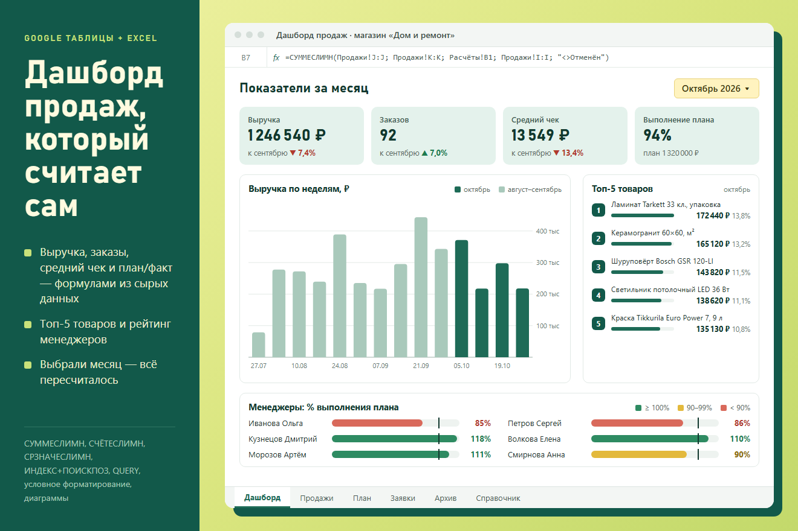
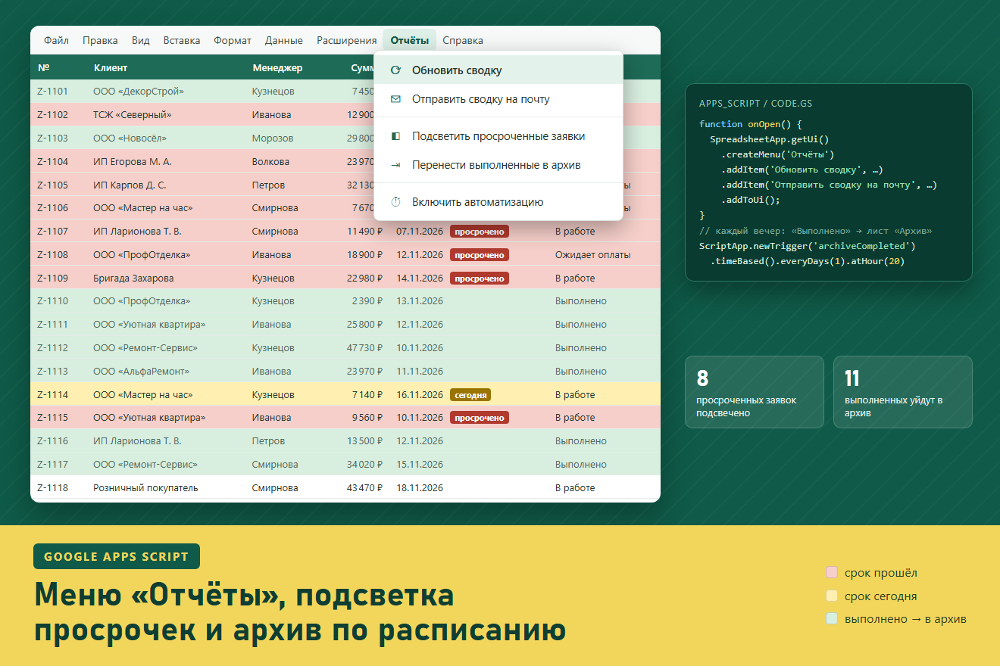
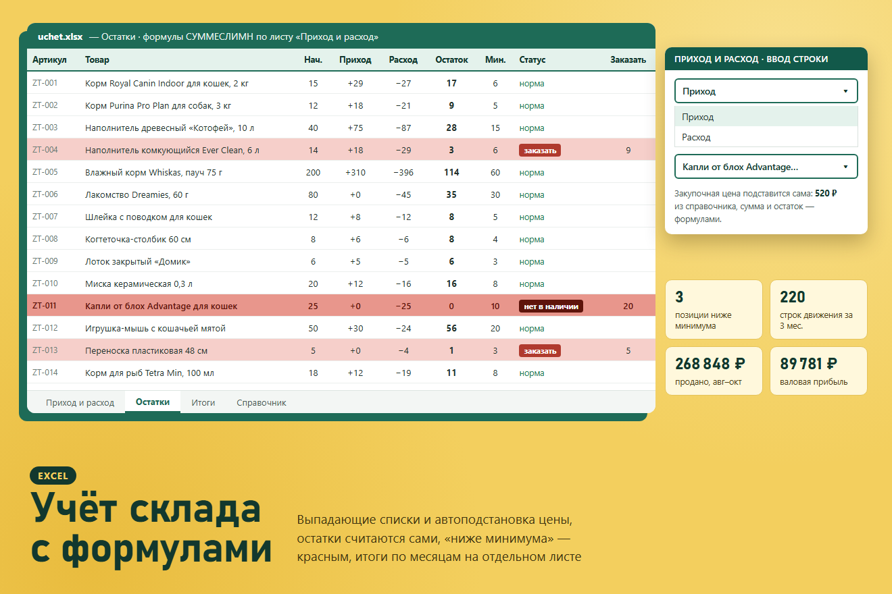

# Дашборд продаж в Google Таблицах и учёт склада в Excel

Два готовых примера:

| Файл | Что это |
|---|---|
| `dashboard.xlsx` | **Дашборд продаж.** Из листа с «сырыми» продажами формулами собираются выручка за месяц, число заказов, средний чек, топ-5 товаров, рейтинг менеджеров с планом и фактом, динамика по неделям, итоги по месяцам и две диаграммы. Открывается в Excel и загружается в Google Таблицы. |
| `apps_script/Code.gs` | **Скрипт для Google Таблиц.** Добавляет меню «Отчёты» («Обновить сводку», «Отправить сводку на почту»), подсвечивает просроченные заявки, а выполненные каждый вечер переносит в архив. |
| `uchet.xlsx` | **Учёт склада в Excel.** Приход и расход с выпадающими списками, цена подставляется сама, остатки считаются формулами, «ниже минимума» подсвечивается красным, на отдельном листе итоги по месяцам. |

Все данные в файлах выдуманы для примера: магазин «Дом и ремонт» (281 продажа за август–октябрь 2026) и зоомагазин (220 строк прихода и расхода).

---

## Как выглядит результат

**Дашборд.** Месяц выбирается в выпадающем списке, после этого пересчитываются плитки, топ-5 и план/факт.



**Google Apps Script.** Меню «Отчёты», подсветка просрочек, архив по расписанию.



**Учёт склада.** Лист «Остатки»: строки, где остаток ниже минимума, подсвечены красным.



---

## A. Дашборд продаж (`dashboard.xlsx`)

### Что умеет

* **Плитки с показателями за выбранный месяц:** выручка, число заказов, средний чек, процент выполнения плана. Под каждой плиткой есть сравнение с прошлым месяцем со стрелкой ▲/▼ (рост зелёным, падение красным).
* **Топ-5 товаров** по выручке за месяц: количество, сумма и доля в выручке.
* **Рейтинг менеджеров: план и факт.** Процент выполнения подсвечивается: от 100 % зелёным, 90–99 % жёлтым, меньше 90 % красным. Отклонение в рублях окрашено в красный или зелёный.
* **Динамика выручки по неделям** (таблица и диаграмма) и **итоги по месяцам** (выручка, заказы, средний чек, отмены).
* **Счётчик просроченных заявок** с листа «Заявки».
* Отменённые заказы в выручку не входят.

### Листы

| Лист | Что на нём | Трогать? |
|---|---|---|
| **Дашборд** | Показатели, таблицы и диаграммы. Месяц выбирается в жёлтой ячейке **C4** | Только C4 |
| **Продажи** | Сырые данные. Колонки A–I: дата, № заказа, клиент, менеджер, товар, категория, кол-во, цена, статус. Колонки J–L (сумма, месяц, неделя) считаются формулами | Колонки A–I |
| **План** | План продаж: менеджер, месяц (первое число месяца), сумма | Да |
| **Заявки** | Текущие заявки со сроками. С этим листом работает скрипт | Да |
| **Архив** | Сюда скрипт переносит выполненные заявки | Нет |
| **Справочник** | Список месяцев для выпадающего списка, товары и менеджеры | Да, когда появляются новые товары или менеджеры |
| **Расчёты** | Служебный лист: суммы по товарам и менеджерам, из которых строятся рейтинги | Нет |

### Какие функции используются

Основа построена на функциях, которые есть и в Excel, и в Google Таблицах. Поэтому файл одинаково считает и там, и там.

| В русском Excel | В Google Таблицах и английском Excel | Для чего |
|---|---|---|
| СУММЕСЛИМН | SUMIFS | выручка за месяц, неделю, по товару, по менеджеру |
| СЧЁТЕСЛИМН | COUNTIFS | число заказов и отмен, просроченные заявки |
| СРЗНАЧЕСЛИМН | AVERAGEIFS | средний чек |
| ИНДЕКС + ПОИСКПОЗ | INDEX + MATCH | выбранный месяц по названию, вывод строк рейтинга |
| НАИБОЛЬШИЙ | LARGE | сортировка для топ-5 и рейтинга (без QUERY и SORT, которых нет в старом Excel) |
| ДАТАМЕС | EDATE | предыдущий месяц для сравнения |
| ДЕНЬНЕД | WEEKDAY | начало недели (понедельник) |
| ЕСЛИОШИБКА | IFERROR | пустая ячейка вместо ошибки, если данных ещё нет |

### Как загрузить в Google Таблицы

1. Откройте [drive.google.com](https://drive.google.com) → **Создать** → **Загрузить файл** → выберите `dashboard.xlsx`.
2. Дважды щёлкните по файлу. Наверху нажмите **Файл → Сохранить как Google Таблицу**. Появится копия, которая работает как обычная Google Таблица: формулы, выпадающий список, подсветка и диаграммы переносятся.
3. Проверьте региональные настройки: **Файл → Настройки → Региональные настройки: Россия**. Тогда даты и рубли будут в привычном виде.

### Как поставить скрипт (меню «Отчёты»)

1. В Google Таблице откройте меню **Расширения → Apps Script**.
2. В открывшемся редакторе удалите всё, что есть в файле `Code.gs` (может называться `Код.gs`), и вставьте целиком текст из `apps_script/Code.gs`.
3. Нажмите **Сохранить** (значок дискеты или Ctrl+S).
4. В списке функций над кодом выберите `onOpen` и нажмите **Выполнить**. Google попросит разрешение: **Проверить разрешения** → выберите свой аккаунт → **Дополнительные настройки** → **Перейти на страницу «…» (небезопасно)** → **Разрешить**.
   Такое предупреждение появляется у любого скрипта, который вы написали для себя и не отправляли Google на проверку. Скрипт работает только с этой таблицей и отправляет письма от вашего имени.
5. Вернитесь в таблицу и обновите страницу (F5). Справа от «Справки» появится меню **«Отчёты»**.
6. Чтобы перенос в архив и подсветка работали сами каждый день: **Отчёты → Включить автоматизацию**.

Что делают пункты меню:

| Пункт | Что происходит |
|---|---|
| Обновить сводку | Обновляет подсветку просрочек, записывает время обновления в ячейку I4 дашборда и показывает короткую сводку во всплывающем окне |
| Отправить сводку на почту | Спрашивает подтверждение и присылает письмо: показатели месяца, топ-5 товаров, менеджеры, число просроченных заявок |
| Подсветить просроченные заявки | На листе «Заявки» просроченные строки становятся красными, со сроком «сегодня» — жёлтыми, выполненные — зелёными. При ручной правке строка перекрашивается сразу |
| Перенести выполненные в архив | Переносит строки со статусом «Выполнено» на лист «Архив» и добавляет дату переноса |
| Включить / выключить автоматизацию | Включает или выключает расписание: перенос в архив каждый день около 20:00, подсветка каждое утро около 7:00. Повторное включение дублей не создаёт |

Настройки находятся в начале `Code.gs`:

* `EMAIL_TO` — адрес для сводки. Если оставить пустым, письмо придёт владельцу таблицы.
* `SEND_WEEKLY_EMAIL` — `true`, если сводка должна сама приходить по понедельникам в 9:00.
* `ARCHIVE_HOUR` — час переноса в архив.
* Названия листов и номера колонок.

Если время срабатывания не совпадает с вашим, в редакторе Apps Script откройте **Настройки проекта** (шестерёнка) и поставьте часовой пояс «(GMT+03:00) Москва» или свой.

### Как подставить свои данные

1. **Продажи.** Удалите демо-строки в колонках **A–I** листа «Продажи» и вставьте свои в том же порядке: дата, № заказа, клиент, менеджер, товар, категория, кол-во, цена, статус. Колонки J–L с формулами не трогайте: они протянуты до 1000-й строки. Если строк больше, выделите J–L последней строки и протяните вниз, а в формулах листов «Дашборд» и «Расчёты» замените `1000` на нужное число (Ctrl+H).
   Отменённые заказы отмечайте статусом ровно **«Отменён»**: такие строки не попадают в выручку.
2. **Справочник.** Впишите свои товары (колонка D) и менеджеров (колонка H). Названия должны совпадать с теми, что стоят в «Продажах», буква в букву. Поместится до 30 товаров и до 10 менеджеров. В рейтинге на дашборде показываются первые 6 менеджеров; если менеджеров больше, вставьте строки в таблицу рейтинга и скопируйте в них формулы.
3. **План.** Одна строка — план одного менеджера на месяц. Месяц указывается первым числом: `01.11.2026`.
4. **Месяцы.** В «Справочнике» уже есть все месяцы 2026 года. Для 2027-го допишите строки «Январь 2027» с датой `01.01.2027` и так далее, а в проверке данных ячейки C4 расширьте диапазон.
5. **Недели.** Таблица недель на дашборде начинается с понедельника 27.07.2026. Впишите в ячейку H22 понедельник первой недели своих данных, остальные недели пересчитаются.

### Вариант на QUERY (только для Google Таблиц)

В Google Таблицах те же отчёты можно собрать функцией QUERY, одной формулой на таблицу. В Excel QUERY нет, поэтому в файле основа сделана на СУММЕСЛИМН. Ниже готовые формулы: их можно вставить в любую свободную ячейку, например на новом листе.

Названия функций в Google Таблицах можно писать по-английски при любом языке интерфейса. Разделитель аргументов в русской локали — точка с запятой. Внутри QUERY колонки обозначаются как `Col1…Col12` (A = Col1, E = Col5, J = Col10). Пустые строки и выбранный месяц отсекает FILTER, поэтому формулы работают и с «хвостом» пустых строк.

**Топ-5 товаров за месяц, выбранный в C4:**

```
=IFERROR(QUERY(FILTER(Продажи!A2:L; Продажи!A2:A<>""; Продажи!I2:I<>"Отменён"; Продажи!K2:K=Расчёты!B1);
  "select Col5, sum(Col7), sum(Col10) group by Col5 order by sum(Col10) desc limit 5
   label Col5 'Товар', sum(Col7) 'Кол-во', sum(Col10) 'Выручка'"; 0); "нет данных")
```

**Менеджеры за выбранный месяц, по убыванию выручки:**

```
=IFERROR(QUERY(FILTER(Продажи!A2:L; Продажи!A2:A<>""; Продажи!I2:I<>"Отменён"; Продажи!K2:K=Расчёты!B1);
  "select Col4, count(Col2), sum(Col10) group by Col4 order by sum(Col10) desc
   label Col4 'Менеджер', count(Col2) 'Заказов', sum(Col10) 'Выручка'"; 0); "нет данных")
```

**Выручка по неделям за весь период:**

```
=QUERY(FILTER(Продажи!A2:L; Продажи!A2:A<>""; Продажи!I2:I<>"Отменён");
  "select Col12, sum(Col10), count(Col2) group by Col12 order by Col12
   label Col12 'Неделя с', sum(Col10) 'Выручка', count(Col2) 'Заказов'"; 0)
```

**Сводная «менеджер × месяц»:**

```
=QUERY(FILTER(Продажи!A2:L; Продажи!A2:A<>""; Продажи!I2:I<>"Отменён");
  "select Col4, sum(Col10) group by Col4 pivot Col11 label Col4 'Менеджер'"; 0)
```

У результатов QUERY задайте формат «Финансы» или «₽» (**Формат → Числа**), иначе суммы будут без разделителей.

---

## B. Учёт склада в Excel (`uchet.xlsx`)

### Что умеет

* **«Приход и расход».** Каждая строка — одна операция. В колонках «Операция» и «Товар» выпадающие списки, кол-во принимается только целым числом больше нуля, дата — только датой. Цена подставляется сама из справочника: для прихода закупочная, для расхода цена продажи. Сумма, себестоимость и месяц считаются формулами (серые колонки F–I).
* **«Остатки».** По каждому товару: остаток на начало, приход, расход, текущий остаток, минимум, статус («Норма», «Заказать», «Нет в наличии»), сколько рекомендуем заказать (до двух минимумов) и стоимость остатка по закупке.
  Строка розовеет, когда остаток ниже минимума, и становится ярко-красной, когда товара нет.
* **«Итоги».** По месяцам учётного года: закуплено, продано, себестоимость проданного, валовая прибыль, маржа, число продаж. Ниже таблица «товар × месяц» в штуках, рядом диаграмма «закупки / продажи».
* **«Справочник».** Артикул, товар, единица, цены закупки и продажи, минимальный остаток, остаток на начало учёта.

### Как вести учёт

1. Новая операция — новая строка на листе «Приход и расход»: дата, «Приход» или «Расход», товар из списка, количество, контрагент. Цена, сумма и остатки посчитаются сами.
2. **Новый товар:** добавьте строку в конец «Справочника». Товар сразу появится в выпадающем списке, на листе «Остатки» и в таблице «товар × месяц». Строки там заготовлены заранее, всего до 30 товаров.
3. **Месяцы:** на листе «Итоги» уже заведён учётный год с августа 2026 по июль 2027. Будущие месяцы стоят с нулями и заполнятся сами, когда появятся операции. Чтобы начать другой год, поменяйте названия в колонке A и даты в колонке B: первое число месяца, например `01.08.2027`.
4. Формулы протянуты до 1000-й строки. Если операций больше, протяните F–I вниз и замените `1000` в формулах «Остатков» и «Итогов» (Ctrl+H).
5. Чтобы начать учёт с нуля, удалите демо-строки в колонках A–E листа «Приход и расход», а в «Справочнике» впишите свои товары и остатки на начало.

---

## Контрольные числа («должно получиться»)

Эти числа посчитаны отдельно на Python по тем же сырым данным. При открытии файлов формулы должны показать то же самое.

### `dashboard.xlsx`, месяц в C4 — «Октябрь 2026» (стоит по умолчанию)

| Показатель | Значение |
|---|---|
| Выручка за месяц | **1 246 540 ₽** (к сентябрю ▼ 7,4 %) |
| Заказов (без отмен) | **92** (▲ 7,0 %), отменено 11 |
| Средний чек | **13 549 ₽** (точнее 13 549,35; ▼ 13,4 %) |
| План на месяц / выполнение | **1 320 000 ₽ / 94 %** (94,4 %) |

Топ-5 товаров за октябрь:

| № | Товар | Кол-во | Выручка | Доля |
|---|---|---|---|---|
| 1 | Ламинат Tarkett 33 кл., упаковка | 92 | 172 440 ₽ | 13,8 % |
| 2 | Керамогранит 60×60, м² | 128 | 165 120 ₽ | 13,2 % |
| 3 | Шуруповёрт Bosch GSR 120-LI | 18 | 143 820 ₽ | 11,5 % |
| 4 | Светильник потолочный LED 36 Вт | 58 | 138 620 ₽ | 11,1 % |
| 5 | Краска Tikkurila Euro Power 7, 9 л | 21 | 135 130 ₽ | 10,8 % |

Менеджеры за октябрь, рейтинг по факту:

| Менеджер | План | Факт | % плана | Отклонение |
|---|---|---|---|---|
| Иванова Ольга | 530 000 ₽ | 448 500 ₽ | 85 % (красный) | −81 500 ₽ |
| Петров Сергей | 270 000 ₽ | 233 110 ₽ | 86 % (красный) | −36 890 ₽ |
| Кузнецов Дмитрий | 150 000 ₽ | 177 010 ₽ | 118 % (зелёный) | +27 010 ₽ |
| Волкова Елена | 160 000 ₽ | 175 680 ₽ | 110 % (зелёный) | +15 680 ₽ |
| Морозов Артём | 110 000 ₽ | 121 840 ₽ | 111 % (зелёный) | +11 840 ₽ |
| Смирнова Анна | 100 000 ₽ | 90 400 ₽ | 90 % (жёлтый) | −9 600 ₽ |
| **Итого** | **1 320 000 ₽** | **1 246 540 ₽** | **94 %** | **−73 460 ₽** |

Итоги по месяцам. Эта таблица и недели от выбора месяца не зависят:

| Месяц | Выручка | Заказов | Средний чек | Отмен | План | % плана |
|---|---|---|---|---|---|---|
| Август 2026 | 1 302 470 ₽ | 81 | 16 080 ₽ | 5 | 1 370 000 ₽ | 95 % |
| Сентябрь 2026 | 1 346 280 ₽ | 86 | 15 654 ₽ | 6 | 1 450 000 ₽ | 93 % |
| Октябрь 2026 | 1 246 540 ₽ | 92 | 13 549 ₽ | 11 | 1 320 000 ₽ | 94 % |
| **Итого** | **3 895 290 ₽** | **259** | **15 040 ₽** | **22** | | |

Если выбрать «Сентябрь 2026», первое место в топе займёт «Керамогранит 60×60, м²» (481 380 ₽, 35,8 %), а первой в рейтинге будет Иванова Ольга (448 640 ₽ из 510 000 ₽, 88 %). Для августа сравнение с прошлым месяцем пустое: за июль данных нет.

Неделя с наибольшей выручкой — с понедельника 21.09.2026: 443 520 ₽, 24 заказа. Сумма всех 14 недель равна выручке за три месяца.

«Просрочено заявок» (ячейка L4) зависит от сегодняшней даты. На 16.11.2026 это **8** из 26 заявок, ещё 11 заявок выполнены и при переносе уйдут в архив.

### `uchet.xlsx`

Лист «Остатки» (на 31.10.2026):

| Товар | Нач. | Приход | Расход | Остаток | Мин. | Статус |
|---|---|---|---|---|---|---|
| Наполнитель комкующийся Ever Clean, 6 л | 14 | 18 | 29 | **3** | 6 | Заказать (9 шт.) |
| Капли от блох Advantage для кошек | 25 | 0 | 25 | **0** | 10 | Нет в наличии (20 шт.) |
| Переноска пластиковая 48 см | 5 | 0 | 4 | **1** | 3 | Заказать (5 шт.) |
| Остальные 11 товаров | | | | | | Норма |

Всего приход 523 шт., расход 716 шт. Стоимость остатков по закупке — **80 593 ₽**.

Лист «Итоги»:

| Месяц | Закуплено | Продано | Себестоимость | Валовая прибыль | Маржа | Продаж |
|---|---|---|---|---|---|---|
| Август 2026 | 24 940 ₽ | 94 034 ₽ | 63 350 ₽ | 30 684 ₽ | 32,6 % | 66 |
| Сентябрь 2026 | 85 200 ₽ | 89 649 ₽ | 59 617 ₽ | 30 032 ₽ | 33,5 % | 70 |
| Октябрь 2026 | 28 090 ₽ | 85 165 ₽ | 56 100 ₽ | 29 065 ₽ | 34,1 % | 65 |
| Ноябрь 2026 – Июль 2027 | 0 ₽ | 0 ₽ | 0 ₽ | 0 ₽ | 0,0 % | 0 |
| **Итого** | **138 230 ₽** | **268 848 ₽** | **179 067 ₽** | **89 781 ₽** | **33,4 %** | **201** |

---

## Для разработчика

* `python build.py` — заново собирает оба xlsx и печатает контрольные числа. Данные генерируются с фиксированным seed, поэтому файлы каждый раз получаются одинаковыми. Нужен `openpyxl`.
* `python check.py` — пересчитывает формулы обоих файлов движком [pycel](https://github.com/dgorissen/pycel) и сравнивает результат с независимым расчётом на Python по сырым данным из тех же файлов. Проверяются все плитки, топ-5, рейтинг менеджеров и итоги для августа, сентября и октября, все недели, автоподстановка цены в каждой строке движения, все остатки, итоги и таблица «товар × месяц». Проверяются и пустые заготовленные строки, и будущие месяцы. Всего 1107 значений, расхождений 0.
